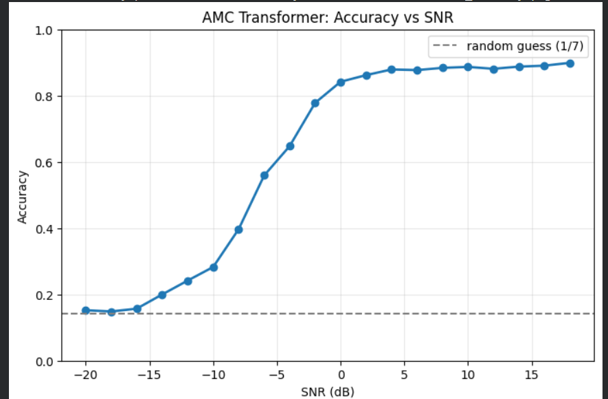
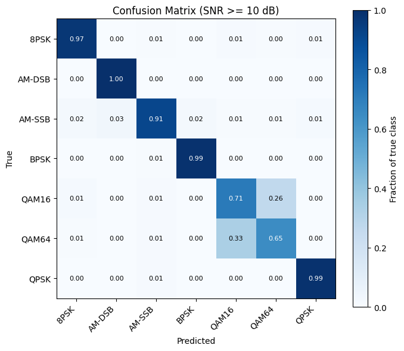
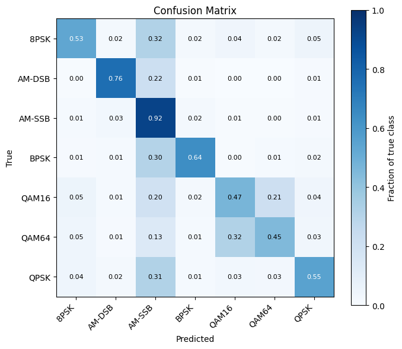
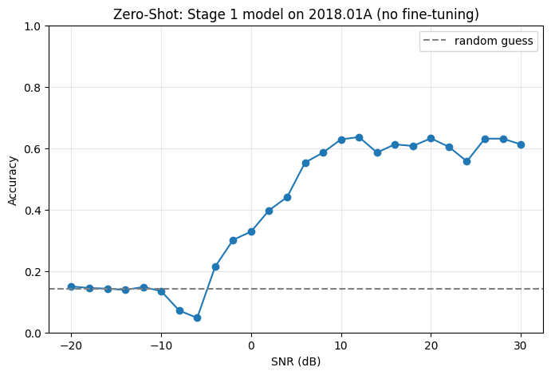
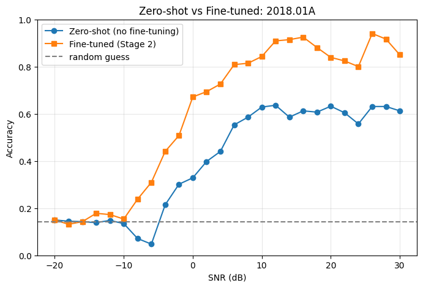
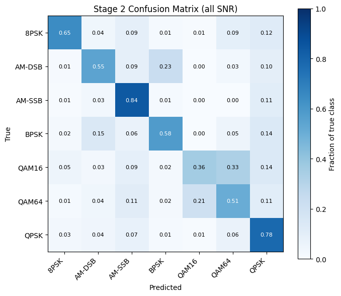

# AMC Transformer — Evaluation Results

This document presents the evaluation plots and key observations for the Automatic Modulation Classification (AMC) Transformer experiments across RadioML2016.10a and RadioML2018.01A. The figures are embedded using relative paths, so they render on GitHub when this directory structure is preserved.

## 1. Stage 1 — RadioML2016.10a Baseline

### 1.1 Accuracy versus SNR



The model is evaluated across SNR values from approximately −20 dB to +18 dB. The dashed line marks the random-guess baseline for seven classes, \(1/7 \approx 14.3\%\).

**Observations**
- At very low SNR, accuracy is close to random guessing.
- Accuracy rises as SNR improves, reaching approximately 78% at −2 dB and 84% at 0 dB.
- At positive SNR, accuracy levels off at approximately 87–90%.

### 1.2 Confusion matrix at SNR ≥ 10 dB



The rows are normalized by true class, so diagonal values represent per-class recall for this evaluated subset.

| True modulation | Recall |
|---|---:|
| 8PSK | 0.97 |
| AM-DSB | 1.00 |
| AM-SSB | 0.91 |
| BPSK | 0.99 |
| QAM16 | 0.71 |
| QAM64 | 0.65 |
| QPSK | 0.99 |

Most classes have high recall at high SNR. The main confusion is between QAM16 and QAM64: 26% of true QAM16 examples are predicted as QAM64, while 33% of true QAM64 examples are predicted as QAM16.

### 1.3 Confusion matrix across all SNR values



Approximate diagonal values from the plotted matrix:

| True modulation | Recall |
|---|---:|
| 8PSK | 0.53 |
| AM-DSB | 0.76 |
| AM-SSB | 0.92 |
| BPSK | 0.64 |
| QAM16 | 0.47 |
| QAM64 | 0.45 |
| QPSK | 0.55 |

Performance across all SNR levels is lower for several classes than in the high-SNR subset. AM-SSB is comparatively well recognized, while QAM16 and QAM64 remain difficult to distinguish.

## 2. Cross-Dataset Transfer — RadioML2018.01A

### 2.1 Zero-shot evaluation (no fine-tuning)



This plot evaluates the Stage 1 model on RadioML2018.01A without fine-tuning.

**Observations**
- At low SNR, accuracy is near or below the random-guess reference at several points.
- Accuracy rises with SNR.
- At higher SNR, accuracy is generally around 58–64%.

This indicates some cross-dataset generalization, but a clear performance gap remains compared with the source-domain high-SNR results.

### 2.2 Zero-shot versus fine-tuned model



The plot compares the zero-shot model with the Stage 2 fine-tuned model on RadioML2018.01A.

**Observations**
- Fine-tuning substantially improves accuracy across much of the moderate- and high-SNR range.
- Around 0 dB, the plotted accuracy is approximately 0.67 for the fine-tuned model versus 0.33 for zero-shot.
- Around 10–20 dB, fine-tuned accuracy is approximately 0.84–0.91, while zero-shot accuracy is approximately 0.60–0.64.
- The curves are not perfectly monotonic; individual SNR points fluctuate.

The improvement depends on SNR. For a formal headline metric, compute the gain from the underlying evaluation results over a clearly defined SNR range.

## 3. Stage 2 — Fine-Tuned RadioML2018.01A

### 3.1 Confusion matrix across all SNR values



The matrix shows the fraction of predictions for each true class across all evaluated SNR values.

| True modulation | Diagonal recall |
|---|---:|
| 8PSK | 0.65 |
| AM-DSB | 0.55 |
| AM-SSB | 0.84 |
| BPSK | 0.58 |
| QAM16 | 0.36 |
| QAM64 | 0.51 |
| QPSK | 0.78 |

**Observations**
- AM-SSB has the strongest diagonal value (0.84), followed by QPSK (0.78).
- QAM16 is the most challenging class in this aggregate matrix, with a diagonal value of 0.36.
- QAM16 and QAM64 are frequently confused: 33% of true QAM16 examples are predicted as QAM64, and 21% of true QAM64 examples are predicted as QAM16.
- Some AM-DSB examples are predicted as BPSK (23%).

Fine-tuning improves the SNR-accuracy curve, but aggregate per-class performance remains uneven. QAM16/QAM64 discrimination is a key area for further investigation.

## 4. Overall Findings

1. **SNR strongly affects classification:** accuracy generally improves as signals become less noise-dominated.
2. **High-SNR results are stronger:** most classes achieve high recall in the displayed high-SNR matrix, with QAM16/QAM64 remaining difficult.
3. **Zero-shot transfer is limited:** the model reaches approximately 58–64% accuracy at higher SNR on RadioML2018.01A.
4. **Fine-tuning helps:** Stage 2 improves accuracy substantially across much of the target dataset's moderate- and high-SNR range.
5. **Per-class results matter:** overall accuracy alone can hide confusion between modulation formats.

## 5. Interpretation Notes

- The confusion matrices are row-normalized. Their diagonal entries represent **per-class recall**, not precision or overall accuracy.
- The numerical descriptions are approximate readings from the supplied plots.
- Verify the dataset and model-stage association of the high-SNR confusion matrix against the script that generated it; its plot title only states `SNR ≥ 10 dB`.
- For reproducibility, include the dataset split, model checkpoint, evaluation code, and exact metrics in the repository when available.

## 6. Repository Layout

```text
your-repository/
├── RESULTS.md
└── results/
    ├── snr_accuracy.png
    ├── confusion_matrix_high_snr.png
    ├── confusion_matrix_all.png
    ├── zero_shot_snr_accuracy.png
    ├── zeroshot_vs_finetuned.png
    └── stage2_confusion_matrix_all.png
```
